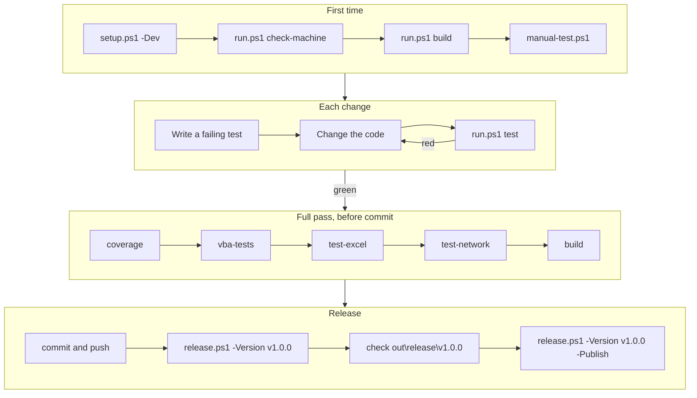
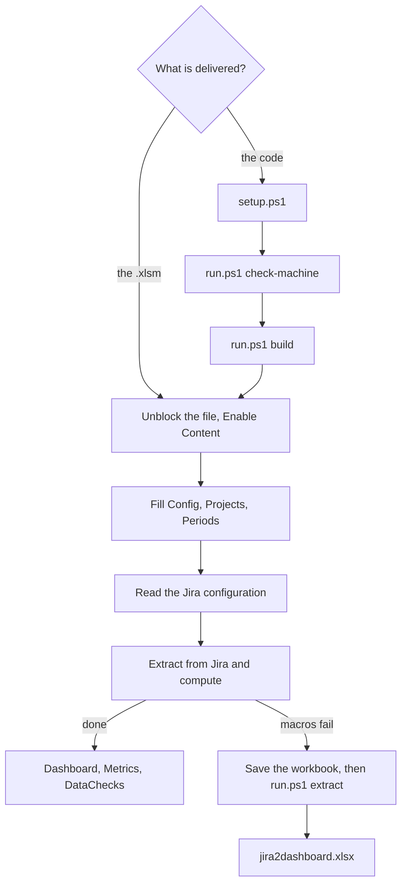

# jira2dashboard

jira2dashboard computes the six SAFe flow metrics and 29 data-quality checks from Jira Cloud, and shows them on a
dashboard in an Excel workbook, for the RTE of an Agile Release Train. The workbook needs Excel only: VBA reads Jira,
Excel formulas compute every figure. No server, no Python at run time, and the data stays on the machine.

## Contents

1. [Quick start](#1-quick-start)
2. [Overview](#2-overview)
3. [How it works](#3-how-it-works)
4. [Repository layout](#4-repository-layout)
5. [Requirements](#5-requirements)
6. [Scripts and commands](#6-scripts-and-commands)
7. [Workflows](#7-workflows)
8. [Configuration](#8-configuration)
9. [Using the workbook](#9-using-the-workbook)
10. [Python extraction without VBA](#10-python-extraction-without-vba)
11. [Metrics and data checks](#11-metrics-and-data-checks)
12. [Logs and debugging](#12-logs-and-debugging)
13. [Testing](#13-testing)
14. [Release](#14-release)

## 1. Quick start

On a developer machine that meets the [requirements](#5-requirements), in PowerShell, from the repository folder:

```powershell
powershell -ExecutionPolicy Bypass -File scripts\setup.ps1 -Dev   # .venv with pywin32 and the test tools
.\scripts\run.ps1 check-machine                                   # 22 checks, all OK
.\scripts\run.ps1 test                                            # fast tests, under a minute
.\scripts\run.ps1 build                                           # out\release\jira2dashboard.xlsm
.\scripts\manual-test.ps1                                         # fake Jira + filled copy in a new Excel
```

In the copy: **Enable Content**, **Read the Jira configuration**, then **Extract from Jira and compute**. Stop the
fake Jira with `.\scripts\stop-mock.ps1`. Excel may crash after the last search page
([known defect](#symptoms)): save your other work first, or try `manual-test.ps1 -Python`.

## 2. Overview

| Deliverable | What it is | Made by |
|---|---|---|
| `jira2dashboard.xlsm` | The workbook to deliver. Needs Excel only. | `run.ps1 build` |
| `jira2dashboard.xlsx` | Fallback when macros cannot run: values and SVG charts. | `run.ps1 extract` |
| `rovo/*.md` | Rovo Studio agents that read the published figures. | Written by hand |

- Windows 11, Excel 365 or 2021 (dynamic array formulas). Python builds and tests the workbook; its runtime is
  pywin32 + the standard library.
- Site values (URL, account, token, proxy, filter, field ids, as-of date, calendar) stay empty in the repository and
  are typed in the workbook. Statuses, transitions and fields are **workbook parameters**, never code.

## 3. How it works

- **Python generates, Excel computes.** The build writes the parameter sheets, empty raw sheets and a *plan*, and
  injects the VBA. VBA writes raw data only; every figure is a visible Excel formula.
- **Formulas and charts are data.** The plan (sheets `FlowFormulas`, `ChartSpec`, `ChecksSpec`) comes from
  `flow/formulas.py` and `flow/dashboard_spec.py`. After each extraction `modFlowBuild` rebuilds every table and chart
  from it. A new metric or check edits the plan, not the VBA.
- **A Python reference is the oracle.** `flow/` computes the same metrics and checks; the Excel tests compare the
  workbook with it, cell by cell.

```
BUILD  developer machine, Python

  params/*.md ---+
  vba/*.bas  ----+---> run.ps1 build ---> jira2dashboard.xlsm
  flow/ plan ----+


RUN  user machine, Excel + VBA

  Jira Cloud REST API v3
        |
        |  1. read Jira       modHttp, modProxy, modJira (WinHTTP, proxy, Windows auth)
        |  2. write raw data  modExtract, modFlow
        v
  Issues, StatusIntervals, IssueLinks                       raw sheets (values)
        |
        |  3. rebuild         modFlowBuild, from the plan sheets
        v
  Controls, ItemFlow, DailyLoad, Metrics,                   computed sheets (formulas)
  FillRates, DataChecks, ChartData
        |
        v
  Dashboard: 8 charts, status cell A3


FALLBACK  Python, no VBA

  saved .xlsm ---> run.ps1 extract ---> standalone/ ---> Jira ---> flow/ ---> jira2dashboard.xlsx
```

The extraction runs in slices (`Application.OnTime`), so Excel stays usable and **Cancel** works. HTTP 429 and 5xx
are retried (2 s × 2^n up to 30 s, or `Retry-After` up to 120 s). Previous results are cleared only after Jira has
answered.

| Sheets | Content | Written by |
|---|---|---|
| `Dashboard`, `Manual` | Buttons, status `A3`, charts, team `B2`; user manual | build |
| `Config`, `Projects`, `Periods`, `PIs`, `Workflows`, `Transitions`, `FieldMapping` | Parameters | build, then user |
| `Issues`, `StatusIntervals`, `IssueLinks` | Raw data (values) | VBA |
| `Controls`, `ItemFlow`, `DailyLoad`, `Metrics`, `FillRates`, `DataChecks`, `ChartData` | Results (formulas) | VBA |
| `FlowFormulas`, `ChartSpec`, `ChecksSpec` | The plan. Do not edit. | build |
| `JiraIssueTypes`, `JiraStatuses`, `JiraWorkflows`, `JiraTransitions`, `JiraFields` | Proposals read from Jira | VBA |

## 4. Repository layout

| Path | Content |
|---|---|
| `src/jira2dashboard/flow/` | Python reference (metrics, checks) and the plan (formulas, charts) |
| `src/jira2dashboard/params/` | Reads and validates `params/*.md`, writes the parameter sheets |
| `src/jira2dashboard/standalone/` | Python extraction without VBA |
| `src/jira2dashboard/mockjira/` | The fake Jira |
| `src/jira2dashboard/excel/`, `testbench/`, `cli/` | COM layer, VBA test runner, `check-machine` |
| `src/jira2dashboard/*.py` | `build_workbook`, `clean`, `mock_workbook`, `manual`, `paths` |
| `vba/` | 16 modules; 13 delivered (`modTests`, `modButtons`, `modBackground` are test only) |
| `params/` | Parameter tables (section [8](#8-configuration)) |
| `tests/` | `unit/` (no Excel), `features/` + `steps/` (Gherkin), `integration/` |
| `scripts/` | PowerShell entry points (section [6](#6-scripts-and-commands)) |
| `docs/`, `rovo/` | Domain references (frozen); Rovo agents and Confluence template |
| `out/release/`, `out/manual_test/` | Delivered files; manual-test copy. Never cleaned. |
| `out/inter/` | Everything else. Emptied by `build`. |

## 5. Requirements

- **Developer:** Windows 11, PowerShell 5.1, Python 3.14 (`py`), Excel 365 with **Trust access to the VBA project
  object model** (File > Options > Trust Center > Macro Settings).
- **User:** Excel 365 or 2021 with macros. Python 3.14 + pywin32 only to build there or to use `run.ps1 extract`.

## 6. Scripts and commands

Every script and command answers `--help`. Script options start with `-`, `run.ps1` command options with `--`. If
PowerShell refuses to run scripts: `powershell -ExecutionPolicy Bypass -File scripts\<script>.ps1`. Call `run.ps1`
directly, without `cmd /c` or `2>&1`.

| Script | What it does | Options |
|---|---|---|
| `setup.ps1` | Creates `.venv`, installs pywin32 (plus test tools with `-Dev`) | `-Dev`, `-Proxy` |
| `activate.ps1` | Optional: activates `.venv` in the console (dot-source it) | none |
| `run.ps1` | Runs a command (table below) | `<command> [options]` |
| `start-mock.ps1` | Starts the fake Jira (`mock@example.com` / `mock-token`), prints the `python.exe` that serves it | `-Port`, `-Issues`, `-Hidden` |
| `stop-mock.ps1` | Stops the fake Jira these scripts started, nothing else | `-Port` |
| `manual-test.ps1` | Writes `out\manual_test\jira2dashboard4manualtest.xlsm`, starts the fake Jira, opens the copy | `-Workbook`, `-Port`, `-Python` |
| `release.ps1` | Builds a release in `out\release\<version>`; `notes.md` has the SHA-256 and MD5 of both files | `-Version`, `-Publish` |

**Double-click launchers.** Every `scripts\*.ps1` has a `.cmd` of the same name (`setup.cmd`, `run.cmd`,
`start-mock.cmd`...): double-click it, or run it from a console. It runs the script with `-ExecutionPolicy Bypass` for
that run only (nothing is changed on the machine, no administrator rights), waits for a key at the end of a
double-click so that the output can be read (`J2D_PAUSE=1` forces the wait from a console), passes its arguments on and
answers `--help`. `release.cmd` only explains itself when it has no arguments (a double-click never builds or
publishes); `activate.cmd` opens a console with `.venv` activated. `_launch.cmd` is the shared helper.

| Command | What it does | Main options |
|---|---|---|
| `test` | Fast unit and Gherkin tests, no Excel | pytest arguments |
| `coverage` | `test` plus coverage; fails under 90 % | pytest arguments |
| `test-excel` | Scenarios that drive Excel | pytest arguments |
| `test-network` | Excel scenarios that also need the network | pytest arguments |
| `vba-tests` | Builds, compiles and runs the VBA tests | `--offline`, `--bisect`, `--out` |
| `check-machine` | 22 checks: Python, Excel, VBA project access, compile, macro of the built workbook | `--workbook` |
| `diagnose` | Report to paste into a ticket when the macros are blocked | `--workbook` |
| `mock-jira` | The fake Jira on `http://127.0.0.1:8099` | `--anomalies`, `--issues`, `--port` |
| `mock-workbook` | Writes the manual-test copy | `--workbook`, `--port` |
| `build` | Builds `out\release\jira2dashboard.xlsm` | `--out` (to `out\inter`) |
| `clean` | Empties `out\inter`, keeps the test caches | none |
| `extract` | Reads Jira with Python, writes `jira2dashboard.xlsx` | `--workbook`, `--out`, `--team` |

## 7. Workflows

**Developer**



**User**



## 8. Configuration

Parameters are workbook sheets. Their sources are the files of `params/`, which also describe columns and rules.

| Sheet | Source | Holds |
|---|---|---|
| `Config` | [`config.md`](params/config.md) | Connection, proxy, field ids, check settings, log level |
| `Projects` | [`projects.md`](params/projects.md) | Projects to extract: one `Program`, the others `Team` |
| `Periods` | [`periods.md`](params/periods.md) | Iterations `[Start, End[` (empty in the repo) |
| `PIs` | [`pis.md`](params/pis.md) | PI dates (empty in the repo) |
| `Workflows` | [`workflows.md`](params/workflows.md) | Category of each status: Active, Wait, Done, Removed, Backlog |
| `Transitions` | [`transitions.md`](params/transitions.md) | Allowed moves |
| `FieldMapping` | [`field_mapping.md`](params/field_mapping.md) | Columns of the ticket extract |

- `Config` columns: Parameter, **Value** (the only one read), Example, Mandatory, Description. An empty value with
  Mandatory = `True` stops the extraction before any call to Jira (error 608).
- `ProxyServer` empty = the Windows proxy settings (WPAD, PAC, fixed); `DIRECT` = none; else `host:port`.
  `ProxyWindowsAuth` = `Yes` sends the Windows session to the proxy.
- A test refuses an API token in `params/config.md`.

## 9. Using the workbook

The `Dashboard` (from cell `T1`) and the sheet `Manual` repeat these steps.

1. **Unblock** a downloaded file (right-click > Properties > Unblock), open it, **Enable Content**.
2. Fill `Config` (every Mandatory value), `Projects` and `Periods`.
3. **Read the Jira configuration**: writes the proposal sheets `Jira*`. Copy what fits into `Workflows`,
   `Transitions` and the `...Field` rows of `Config`.
4. **Extract from Jira and compute**. **Cancel** keeps the previous results. Run it as often as needed.
5. Read the charts (`B2` picks the team of Flow Distribution), `Metrics` and `DataChecks`.

**Same file, same place.** Keep the name `jira2dashboard.xlsm` (not `jira2dashboard (1).xlsm`) and one folder on every
machine, and replace the file in place for a new version: an allow-list of the endpoint protection on that path or name
then keeps working, a rule on the hash does not (it changes with every build). `run.ps1 diagnose` flags another name.

**Empty `ApiToken` before sharing the workbook**: it is stored in clear text.

## 10. Python extraction without VBA

When the macros cannot run, Python does their work:

```powershell
.\scripts\run.ps1 extract --workbook C:\Data\jira2dashboard.xlsm   # writes C:\Data\jira2dashboard.xlsx
```

- It reads the parameter sheets of the **saved** workbook, then Jira, with the same proxy, retries and error numbers
  as the macros.
- It writes values only: `Run`, `Charts` (8 SVG charts), `Metrics`, `DataChecks`, `FillRates`, `ItemFlow`,
  `DailyLoad`, `Issues`, `StatusIntervals`, `IssueLinks`, `Errors`, and the parameters with `ApiToken` masked.
- On failure nothing is written. Differences from the workbook: no `Metrics` row for a team without items;
  `DailyLoad` stops at `AsOf`.

## 11. Metrics and data checks

Definitions: [`docs/safe-flow-metrics-and-data-checks.md`](docs/safe-flow-metrics-and-data-checks.md). Metrics are
per period and per team; Program features count under "ART".

| Metric | In short |
|---|---|
| Velocity | Issues done in the period |
| Flow Time | Median and P85 from start to done (no valid start or reopened: counted apart) |
| Flow Load | Issues in process at the end of each UTC day, averaged (`FlowLoadMode` A or B) |
| Flow Efficiency | Active / (active + wait) time |
| Flow Distribution | Share of each work type among issues done |
| Flow Predictability | Always "not computable": Jira holds no PI objectives |

A figure that cannot be computed shows "not computable", never 0. Each data check gives the issues at fault
(`Items`) and `OK`, `KO` or `not computable`; filter `ItemFlow` on `DCnn` = 1 to see them.

| Area | Checks |
|---|---|
| Hierarchy and types | DC01–DC03, DC24 |
| Status history and workflow | DC04–DC10, DC27, DC28 |
| Sprints and story points | DC11, DC12, DC15, DC16 |
| Team and PI | DC13, DC14, DC17, DC18, DC29 |
| Dates, business value, fix versions | DC19–DC21, DC26 |
| Dependencies, fill rates | DC22, DC23; DC25 |

## 12. Logs and debugging

| Name | Path | Purpose |
|---|---|---|
| VBA log | `%LOCALAPPDATA%\jira2dashboard\logs\jira2dashboard.log` | `RUN`, `BEGIN`/`END` per step, `ERROR` |
| Python log | `%LOCALAPPDATA%\jira2dashboard\logs\python.log` | Steps, failed Jira calls, tracebacks |
| Status cell | `Dashboard!A3` | Current step, or the error message |
| Unfinished run | `HKCU\Software\VB and VBA Program Settings\jira2dashboard` | Next run logs "previous run did not end" |
| VBA test log | `%TEMP%\jira2dashboard_vba_tests.log` | VBA tests only |
| Fake Jira pid | `%TEMP%\jira2dashboard\mock-jira-<port>.pid` | What `stop-mock.ps1` may stop |
| Test outputs | `out\inter\` | Test workbooks, chart PNGs, `.coverage` |
| Event log | Event Viewer > Application, event 1000 | Faulting module of an Excel crash |

Both logs rotate at 1 MB and stay local. They never hold the token; the Python log holds the JQL and Jira's
messages: **reread a log before sharing it**.

| Error | Cause |
|---|---|
| 600 | No project in `Projects` |
| 601 | Search did not end after 2000 pages |
| 602 | HTTP error after retries (401 account or token, 407 proxy), or `BaseUrl` not https |
| 603 | `Filter` contains `ORDER BY` |
| 604 | `AsOf` empty or not a date |
| 505, 606 | Jira sends the same page again |
| 607 | Not JSON: usually a proxy or login page |
| 608 | Mandatory `Config` values empty |
| 610, 611 | Cancelled; an extraction is already running |
| 620, 621 | Read the Jira configuration: no project, or no end |
| 701–709 | Building the result sheets: `Periods`, missing sheet or column, Excel too old |

### Symptoms

- **Extraction fails:** read `A3`, then the `ERROR` line of the VBA log.
- **Excel crashes right after `END search page N`:** known defect (`0xC0000005` in the VBA engine). Run again in a
  fresh Excel, or use `run.ps1 extract`.
- **Excel hangs:** a VBA error dialog is open; close it. Never kill an Excel the scripts did not start.
- **Proxy:** see the `END proxy` line of the Python log; set `ProxyServer` to `host:port` or `DIRECT`.
- **VBA does not compile:** `run.ps1 vba-tests --bisect`. **Machine not ready:** `run.ps1 check-machine`.
- **Flaky Excel test:** `J2D_ONE_EXCEL=1` (one Excel per module); a fix needs 5 green runs in a row.
- **Macros blocked by the endpoint protection:** `run.ps1 diagnose`, then attach the report to the ticket (hashes,
  Mark of the Web, Office macro policies, security products, VBA log tail; it never opens the workbook nor reads
  `python.log`). Ask for an allow-list on the file name and folder ([section 9](#9-using-the-workbook)): the MD5 changes
  with every build (`release.ps1` writes it in `notes.md`). `start-mock.ps1` prints the `python.exe` to allow for the
  fake Jira. The delivered VBA
  creates only two COM objects, `WinHttp.WinHttpRequest.5.1` and `Scripting.Dictionary` (UTF-8 and Base64 are plain
  VBA; a test guards it). To tell Office from the endpoint protection, `run.ps1 check-machine` opens the built
  workbook with Office's own macro security relaxed and runs a read-only macro: if it runs, look at Office (Mark of the
  Web, Trusted Location, policies: the check says which); if it does not, something outside Office stops the macros.

## 13. Testing

BDD outside (Gherkin in `tests/features/`, French keywords), TDD inside (`tests/unit/`). A new test must fail when
the code is broken on purpose.

| Level | Run with | Excel |
|---|---|---|
| Unit and pure scenarios | `test`, `coverage` (≥ 90 %) | no |
| Excel scenarios (`excel` marker) | `test-excel` | yes |
| Excel + network (`network` marker) | `test-network` | yes |
| VBA tests `T_`, `N_` (100 % of `Cov` markers) | `vba-tests` | yes |

`flow_excel.feature` compares the workbook with the Python reference cell by cell (Flow Load modes A and B);
`standalone.feature` does the same for the Python extraction. The fake Jira (`mockjira/`) serves search, changelogs,
configuration calls, faults and a proxy; `--anomalies` adds the cases the data checks must find.

## 14. Release

```powershell
.\scripts\release.ps1 -Version v1.0.0            # dry run in out\release\v1.0.0
.\scripts\release.ps1 -Version v1.0.0 -Publish   # GitHub release and tag (public)
```

Needs a clean tree (and a pushed commit for `-Publish`). The package holds the code zip, the workbook and
`notes.md` with SHA256. The zip leaves out the `export-ignore` paths (`CLAUDE.md`, the handoff, `archive/`,
`.claude/`, `.venv/`), pinned by `tests/unit/test_release_contents.py`.
