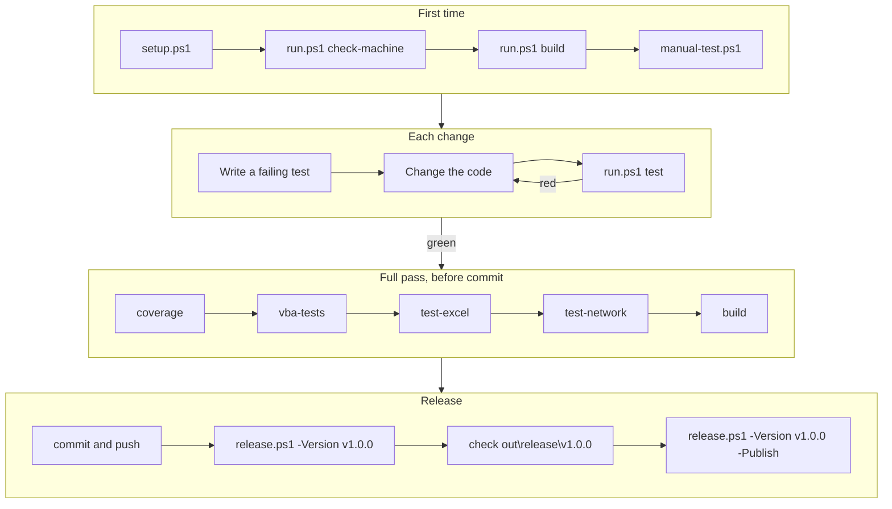

# jira2dashboard

jira2dashboard computes the six SAFe flow metrics and 29 data-quality checks from Jira Cloud, and shows them on a
dashboard in an Excel workbook, for the RTE of an Agile Release Train. The workbook needs Excel only: VBA reads Jira,
Excel formulas compute every figure. No server, no Python at run time, and the data stays on the machine.

## Contents

1. [Quick start](#1-quick-start)
2. [Overview](#2-overview)
3. [How it works](#3-how-it-works)
4. [Repository layout](#4-repository-layout)
5. [Requirements](#5-requirements)
6. [Scripts and commands](#6-scripts-and-commands)
7. [Workflows](#7-workflows)
8. [Configuration](#8-configuration)
9. [Python extraction without VBA](#9-python-extraction-without-vba)
10. [Metrics and data checks](#10-metrics-and-data-checks)
11. [Release](#11-release)

## 1. Quick start

On a developer machine that meets the [requirements](#5-requirements), in PowerShell, from the repository folder:

```powershell
powershell -ExecutionPolicy Bypass -File scripts\bootstrap.ps1    # all of the below in one go (-Full: Excel tests too)
powershell -ExecutionPolicy Bypass -File scripts\setup.ps1        # .venv with pywin32 and the test tools
.\scripts\run.ps1 check-machine                                   # 24 checks, all OK
.\scripts\run.ps1 test                                            # fast tests, under a minute
.\scripts\run.ps1 build                                           # out\release\jira2dashboard.xlsm
.\scripts\manual-test.ps1                                         # fake Jira + filled copy in a new Excel
.\scripts\scenario.ps1                                            # the same chain unattended: Python extraction, checks, clean-up
.\scripts\run.ps1 test-scripts                                    # Pester tests of scripts\*.ps1, coverage under 93 % fails
.\scripts\run.ps1 extract --workbook C:\Data\jira2dashboard.xlsm   # no VBA: Jira -> jira2dashboard.xlsx
```

In the copy: **Enable Content**, **Read the Jira configuration**, then **Extract from Jira and compute**. Stop the
fake Jira with `.\scripts\stop-mock.ps1`. Excel may crash after the last search page
(a known defect): save your other work first, or try `manual-test.ps1 -Python`.
`run.ps1 extract` reads the parameter sheets of a saved workbook ([section 9](#9-python-extraction-without-vba)).

## 2. Overview

| Deliverable | What it is | Made by |
|---|---|---|
| `jira2dashboard.xlsm` | The workbook to deliver. Needs Excel only. | `run.ps1 build` |
| `jira2dashboard.xlsx` | Fallback when macros cannot run: values and SVG charts. | `run.ps1 extract` |
| `rovo/*.md` | Rovo Studio agents that read the published figures. | Written by hand |

- Windows 11, Excel 365 or 2021 (dynamic array formulas). Python builds and tests the workbook; its runtime is
  pywin32 + the standard library.
- Site values (URL, account, token, proxy, filter, field ids, as-of date, calendar) stay empty in the repository and
  are typed in the workbook. Statuses, transitions and fields are **workbook parameters**, never code.

## 3. How it works

- **Python generates, Excel computes.** The build writes the parameter sheets, empty raw sheets and a *plan*, and
  injects the VBA. VBA writes raw data only; every figure is a visible Excel formula.
- **Formulas and charts are data.** The plan (sheets `FlowFormulas`, `ChartSpec`, `ChecksSpec`) comes from
  `flow/formulas.py` and `flow/dashboard_spec.py`. After each extraction `modFlowBuild` rebuilds every table and chart
  from it. A new metric or check edits the plan, not the VBA.
- **A Python reference is the oracle.** `flow/` computes the same metrics and checks; the Excel tests compare the
  workbook with it, cell by cell.

```
BUILD  developer machine, Python

  params/*.md ---+
  vba/*.bas  ----+---> run.ps1 build ---> jira2dashboard.xlsm
  flow/ plan ----+


RUN  user machine, Excel + VBA

  Jira Cloud REST API v3
        |
        |  1. read Jira       modHttp, modProxy, modJira (WinHTTP, proxy, Windows auth)
        |  2. write raw data  modExtract, modFlow
        v
  Issues, StatusIntervals, IssueLinks                       raw sheets (values)
        |
        |  3. rebuild         modFlowBuild, from the plan sheets
        v
  Controls, ItemFlow, DailyLoad, Metrics,                   computed sheets (formulas)
  PIMetrics, FillRates, DataChecks, ChartData
        |
        v
  Dashboard: buttons, status cell A14 and its rows; Charts: 9 charts


FALLBACK  Python, no VBA

  saved .xlsm ---> run.ps1 extract ---> standalone/ ---> Jira ---> flow/ ---> jira2dashboard.xlsx
```

The extraction runs in slices (`Application.OnTime`), so Excel stays usable and **Cancel** works. HTTP 429 and 5xx
are retried (2 s × 2^n up to 30 s, or `Retry-After` up to 120 s). Previous results are cleared only after Jira has
answered.

| Sheets | Content | Written by |
|---|---|---|
| `Dashboard`, `Manual`, `Charts` | Progress bar and buttons stacked in `A2:A12`, status `A14` and one row per field under it; user manual; the 9 charts and their team `B2` | build |
| `Config`, `Projects`, `Iterations`, `PIs`, `Workflows`, `Transitions`, `FieldMapping` | Parameters | build, then user |
| `Issues`, `StatusIntervals`, `IssueLinks` | Raw data (values) | VBA |
| `Controls`, `ItemFlow`, `DailyLoad`, `Metrics`, `PIMetrics`, `FillRates`, `DataChecks`, `ChartData` | Results (formulas) | VBA |
| `FlowFormulas`, `ChartSpec`, `ChecksSpec` | The plan. Do not edit. | build |
| `JiraIssueTypes`, `JiraStatuses`, `JiraWorkflows`, `JiraTransitions`, `JiraFields` | Proposals read from Jira (workflows and moves end with the column Project) | VBA |
| `RovoPromptSpec`, `RovoPrompt` | The text behind the button Prompt for Rovo, and the prompt it writes (a CSV answer is asked: Sheet, Row, Column, Value, Note); the button Load settings CSV loads that answer into Config and the parameter sheets | Python (spec), VBA |
| `JiraProjectWorkflows`, `JiraProjectFields`, `JiraFieldUsage` | Per project: workflow and issue types; fields of the create screen; fields filled in one page of issues | VBA |

## 4. Repository layout

| Path | Content |
|---|---|
| `src/jira2dashboard/flow/` | Python reference (metrics, checks) and the plan (formulas, charts) |
| `src/jira2dashboard/params/` | Reads and validates `params/*.md`, writes the parameter sheets |
| `src/jira2dashboard/standalone/` | Python extraction without VBA |
| `src/jira2dashboard/mockjira/` | The fake Jira |
| `src/jira2dashboard/excel/`, `testbench/`, `cli/` | COM layer, VBA test runner, `check-machine` |
| `src/jira2dashboard/*.py` | `build_workbook`, `clean`, `diagnose`, `error_codes`, `manual`, `mock_workbook`, `paths`, `rovo_prompt`, `version` |
| `vba/` | 16 modules; 13 delivered (`modTests`, `modButtons`, `modBackground` are test only) |
| `params/` | Parameter tables (section [8](#8-configuration)) |
| `tests/` | `unit/` (no Excel), `features/` + `steps/` (Gherkin), `integration/`, `ps/` (Pester tests of the scripts) |
| `scripts/` | PowerShell entry points and their `.cmd` launchers (section [6](#6-scripts-and-commands)); `logs/` holds the log of the last run of each |
| `docs/`, `rovo/` | Domain references (frozen); Rovo agents and Confluence template |
| `pyproject.toml`, `requirements.txt` | pytest and coverage settings; the one list of dependencies (pywin32, test tools) |
| `CLAUDE.md`, `.claude/`, `archive/` | Notes and settings for Claude Code, old probe scripts; left out of GitHub's "Source code" archives |
| `out/release/`, `out/manual_test/` | Delivered files; manual-test copy. Never cleaned. |
| `out/inter/` | Everything else. Emptied by `build`. |

## 5. Requirements

- **Developer:** Windows 11, PowerShell 5.1, Python 3.14 (`py`), Excel 365 with **Trust access to the VBA project
  object model** (File > Options > Trust Center > Macro Settings).
- **User:** Excel 365 or 2021 with macros. Python 3.14 + pywin32 only to build there or to use `run.ps1 extract`.

## 6. Scripts and commands

Every script and command answers `--help`. Script options start with `-`, `run.ps1` command options with `--`. If
PowerShell refuses to run scripts: `powershell -ExecutionPolicy Bypass -File scripts\<script>.ps1`. Call `run.ps1`
directly, without `cmd /c` or `2>&1`.

| Script | What it does | Options |
|---|---|---|
| `bootstrap.ps1` | Everything in one go: `setup.ps1`, `check-machine`, the fast tests, `build` (.xlsm), then the .xlsx through `scenario.ps1`; table of the steps, files made and MD5 of the .xlsm; log `scripts\logs\bootstrap.log` | `-Proxy`, `-Port`, `-Full`, `-SkipTests` |
| `setup.ps1` | Creates `.venv`, installs `requirements.txt` (pywin32 and the test tools) | `-Proxy` |
| `activate.ps1` | Optional: activates `.venv` in the console (dot-source it) | none |
| `run.ps1` | Runs a command (table below) | `<command> [options]` |
| `start-mock.ps1` | Starts the fake Jira (`mock@example.com` / `mock-token`), prints the `python.exe` that serves it | `-Port`, `-Issues`, `-Hidden` |
| `stop-mock.ps1` | Stops the fake Jira these scripts started, nothing else | `-Port` |
| `manual-test.ps1` | Writes `out\manual_test\jira2dashboard4manualtest.xlsm`, starts the fake Jira, opens the copy | `-Workbook`, `-Port`, `-Python` |
| `scenario.ps1` | Plays the whole scenario unattended (fake Jira, filled copy, Python extraction, checks, clean-up); a table of the steps with status and time; `-Excel` adds the macros | `-Workbook`, `-Port`, `-Excel`, `-KeepMock` |
| `release.ps1` | Builds a release in `out\release\<version>`; `notes.md` has the SHA-256 and MD5 of the workbook; no zip of the code | `-Version`, `-Publish` |

**Double-click launchers.** Every `scripts\*.ps1` has a `.cmd` of the same name (`setup.cmd`, `run.cmd`,
`start-mock.cmd`...): double-click it, or run it from a console. It runs the script with `-ExecutionPolicy Bypass` for
that run only (nothing is changed on the machine, no administrator rights), waits for a key at the end of a
double-click so that the output can be read (`J2D_PAUSE=1` forces the wait from a console), passes its arguments on and
answers `--help`. `release.cmd` only explains itself when it has no arguments (a double-click never builds or
publishes); `activate.cmd` opens a console with `.venv` activated. `_launch.cmd` is the shared helper.

| Command | What it does | Main options |
|---|---|---|
| `test` | Fast unit and Gherkin tests, no Excel | pytest arguments |
| `coverage` | `test` plus coverage; fails under 93 % | pytest arguments |
| `test-excel` | Scenarios that drive Excel | pytest arguments |
| `test-network` | Excel scenarios that also need the network | pytest arguments |
| `test-scripts` | Pester tests of `scripts\*.ps1` and their coverage; fails under 93 % | `-Filter`, `-Minimum` |
| `vba-tests` | Builds, compiles and runs the VBA tests | `--offline`, `--bisect`, `--out` |
| `check-machine` | 24 checks: Python, Excel, VBA project access, what Excel writes stays on disk, compile, macro of the built workbook | `--workbook` |
| `diagnose` | Report to paste into a ticket when the macros are blocked | `--workbook` |
| `mock-jira` | The fake Jira on `http://127.0.0.1:8099` | `--anomalies`, `--issues`, `--port` |
| `mock-workbook` | Writes the manual-test copy | `--workbook`, `--port` |
| `build` | Builds `out\release\jira2dashboard.xlsm` | `--out` (to `out\inter`) |
| `clean` | Empties `out\inter`, keeps the test caches | none |
| `extract` | Reads Jira with Python, writes `jira2dashboard.xlsx` | `--workbook`, `--out`, `--team` |

## 7. Workflows

**Developer**



## 8. Configuration

Parameters are workbook sheets. Their sources are the files of `params/`, which also describe columns and rules.

| Sheet | Source | Holds |
|---|---|---|
| `Config` | [`config.md`](params/config.md) | Connection, proxy, field ids, check settings, log level |
| `Projects` | [`projects.md`](params/projects.md) | Projects to extract: one `Program`, the others `Team` |
| `Iterations` | [`iterations.md`](params/iterations.md) | Short cycles inside a PI, `[Start, End[` (empty in the repo) |
| `PIs` | [`pis.md`](params/pis.md) | Long cycles (PI), each holding several iterations (empty in the repo) |
| `Workflows` | [`workflows.md`](params/workflows.md) | Category of each status: Active, Wait, Done, Removed, Backlog |
| `Transitions` | [`transitions.md`](params/transitions.md) | Allowed moves |
| `FieldMapping` | [`field_mapping.md`](params/field_mapping.md) | Columns of the ticket extract |

- `Config` columns: Parameter, **Value** (the only one read), Example, Mandatory, Description. An empty value with
  Mandatory = `True` stops the extraction before any call to Jira (error 608).
- `ProxyServer` empty = the Windows proxy settings (WPAD, PAC, fixed); `DIRECT` = none; else `host:port`.
  `ProxyWindowsAuth` = `Yes` sends the Windows session to the proxy.
- A test refuses an API token in `params/config.md`.

## 9. Python extraction without VBA

When the macros cannot run, Python does their work:

```powershell
.\scripts\run.ps1 extract --workbook C:\Data\jira2dashboard.xlsm   # writes C:\Data\jira2dashboard.xlsx
```

- It reads the parameter sheets of the **saved** workbook, then Jira, with the same proxy, retries and error numbers
  as the macros.
- It writes values only: `Run`, `Charts` (9 SVG charts), `Metrics`, `PIMetrics`, `DataChecks`, `FillRates`, `ItemFlow`,
  `DailyLoad`, `Issues`, `StatusIntervals`, `IssueLinks`, `Errors`, and the parameters with `ApiToken` masked.
- On failure nothing is written. Differences from the workbook: no `Metrics` row for a team without items;
  `DailyLoad` stops at `AsOf`.

## 10. Metrics and data checks

Definitions: [`docs/safe-flow-metrics-and-data-checks.md`](docs/safe-flow-metrics-and-data-checks.md). Metrics are
per iteration and per team; Program features count under "ART".

| Metric | In short |
|---|---|
| Velocity | Issues done in the iteration |
| Flow Time | Median and P85 from start to done (no valid start or reopened: counted apart) |
| Flow Load | Issues in process at the end of each UTC day, averaged (`FlowLoadMode` A or B) |
| Flow Efficiency | Active / (active + wait) time |
| Flow Distribution | Share of each work type among issues done |
| Flow Predictability | Always "not computable": Jira holds no PI objectives |

A figure that cannot be computed shows "not computable", never 0. Each data check gives the issues at fault
(`Items`) and `OK`, `KO` or `not computable`; filter `ItemFlow` on `DCnn` = 1 to see them.

| Area | Checks |
|---|---|
| Hierarchy and types | DC01–DC03, DC24 |
| Status history and workflow | DC04–DC10, DC27, DC28 |
| Sprints and story points | DC11, DC12, DC15, DC16 |
| Team and PI | DC13, DC14, DC17, DC18, DC29 |
| Dates, business value, fix versions | DC19–DC21, DC26 |
| Dependencies, fill rates | DC22, DC23; DC25 |

## 11. Release

```powershell
.\scripts\release.ps1 -Version v1.0.0            # dry run in out\release\v1.0.0
.\scripts\release.ps1 -Version v1.0.0 -Publish   # GitHub release and tag (public)
```

Needs a clean tree (and a pushed commit for `-Publish`). The package holds the workbook and
`notes.md` with its SHA256 and MD5; the release has the workbook only, and GitHub adds its "Source code" archives,
which leave out the `export-ignore` paths (`CLAUDE.md`, `archive/`,
`.claude/`, `.venv/`), pinned by `tests/unit/test_release_contents.py`.
